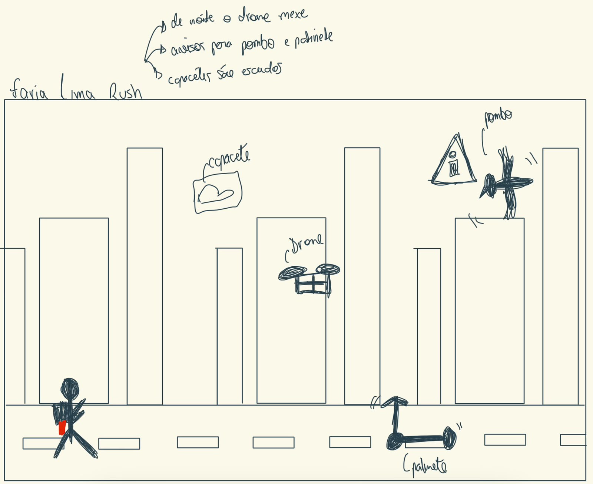

# Faria Lima Rush

Um jovem trabalhador perdeu a hora e precisa chegar ao trabalho. Com o trânsito de São Paulo parado, ele liga o jetpack e vai pelo alto pela Avenida Faria Lima, desviando de drones de entrega, pombos e patinetes desgovernados na calçada. No caminho, pega cafés para ganhar energia e capacetes de obra para se proteger (afinal, as obras de SP nunca acabam).

Projeto Final de Design de Software — Insper, 2026/2.

**Autoras:** Dora Gaudio Guerra e Giovanna Gonçalves Oricchio

**Vídeo do jogo:** https://youtu.be/ntOyYS1SN3o

## Como rodar

1. Instale o PyGame: `pip install pygame` (se der erro, `pip install pygame-ce`)
2. Na pasta do projeto, rode: `python main.py`

## Como jogar

- **Segure ESPAÇO** para voar e solte para cair.
- **P** pausa, **ESC** volta ao menu, **ENTER** começa ou joga de novo, **I** abre as instruções.
- **Café:** +10 pontos. **Capacete:** aguenta uma batida.
- **Drone:** obstáculo no ar (de noite alguns sobem e descem).
- **Pombo:** um aviso pisca na sua altura e, 1 segundo depois, o pombo passa voando rápido.
- **Patinete:** o aviso pisca no chão e o patinete passa pela calçada. Se estiver no chão, perde vida.
- Você tem **3 vidas**. A pontuação é a distância + os cafés, e o recorde fica salvo.
- O jogo tem 3 fases que ficam mais rápidas: **manhã** (até 500 m), **tarde** (até 1500 m, começam os pombos) e **noite**.

## Organização do código

- `main.py`: abre o jogo e troca entre as telas
- `config.py`: todas as constantes (tela, física, velocidades, fases)
- `assets.py`: carrega imagens, sons e fonte
- `sprites.py`: classes do jogo (`Jogador`, `Fundo`, `Drone`, `Item`, `Missil` para o pombo e o patinete, e `Explosao`)
- `gerador.py`: decide quando cada obstáculo e item aparece
- `tela_jogo.py`: loop principal da partida
- `tela_inicio.py`, `tela_instrucoes.py` e `tela_game_over.py`: as outras telas
- `recorde.py`: salva e lê o recorde
- `utils.py`: função para escrever texto na tela

## Design

Começamos desenhando a tela do jogo e as mecânicas principais:

## Créditos

- Imagens, efeitos sonoros e música: gerados com IA (Claude, da Anthropic).
- Fonte Press Start 2P: CodeMan38, [Google Fonts](https://fonts.google.com/specimen/Press+Start+2P), licença SIL Open Font License (`assets/font/OFL.txt`).

## Uso de IA

Usamos o **Claude** (Anthropic) neste projeto:

- **Gerado por IA:** todo o código Python (cada arquivo tem um comentário no topo dizendo isso), todas as imagens e todos os sons.
- **Feito por nós:** a escolha do jogo, do nome, do tema e da história; as ideias do patinete, da calçada e dos sons diferentes para cada aviso; os testes do jogo, nos quais achamos bugs (cafés e patinetes aparecendo em cima de drones e um "tranco" na troca de fase) e pedimos ajustes (patinete mais lento, som do pombo e volume da música); o rascunho, os commits e o vídeo.
- **Como usamos:** pedimos ao Claude um plano dividido em commits e o código de cada etapa. Antes de cada commit, testávamos o jogo e estudávamos a explicação daquela parte (as funções têm marcas `[NÍVEL: FÁCIL/MÉDIO/DIFÍCIL]` para guiar o estudo). Quando achávamos um erro, pedíamos a correção. Estudamos o código inteiro para entender o que cada parte faz.

**Conversas com a IA:**
- Dora: https://claude.ai/share/10b5170c-e24b-4634-a77c-04f2e6d971cb
- Giovanna: [`docs/conversa_giovanna/`](docs/conversa_giovanna/) ([imagens e commits](docs/conversa_giovanna/1_conversa_imagens_e_commits.md), [ajustes finais, README e vídeo](docs/conversa_giovanna/2_conversa_sprites_readme_video.md))

## Referências

- Tutorial de PyGame da disciplina: https://insper.github.io/DesignDeSoftware/pygame/handout/
- Documentação do PyGame: https://www.pygame.org/docs/
